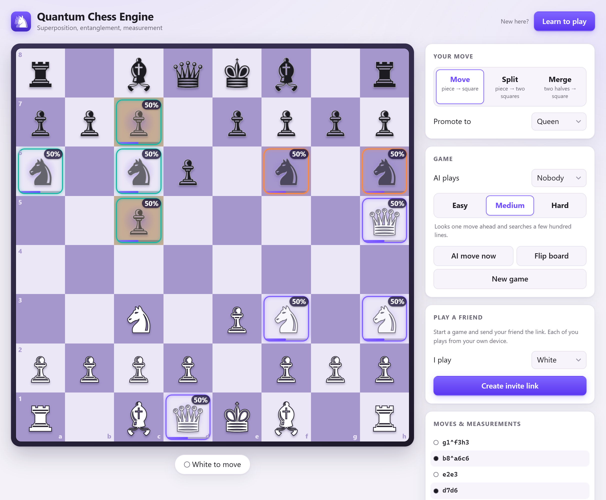
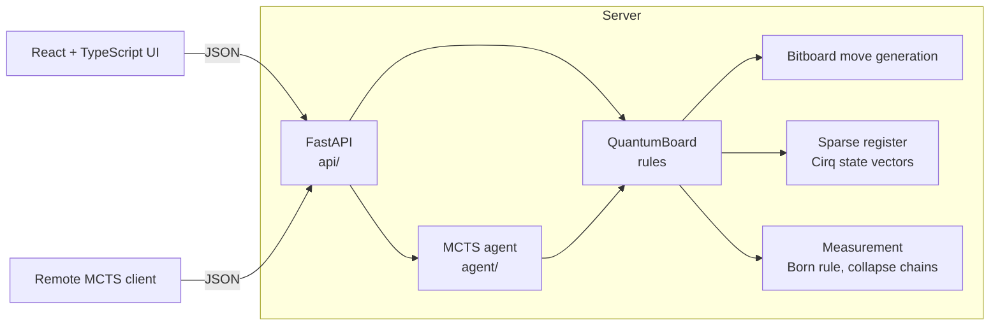

# Quantum Chess

[](https://github.com/Andreas-Erick/Quantum-Chess/actions/workflows/ci.yml)


**Chess where a knight can be on two squares at once.** Pieces can split into **superposition**.
A piece that slides past an uncertain square becomes **entangled** with it. A capture forces a
**measurement** that collapses the board, sometimes in a chain reaction across several pieces.
The quantum state is simulated with Google's [Cirq](https://quantumai.google/cirq). You can play
against a Monte Carlo Tree Search AI in the browser.

<picture>
  <source media="(prefers-color-scheme: dark)" srcset="docs/screenshot-dark.png">
  
</picture>

<sub>Faded pieces with a percentage are in superposition. Squares sharing a ring colour are
entangled. In this position, the white queen slid past the split knight on f3/h3, so it reached h5
only if the knight is on h3 (purple). Black's c-pawn did the same past the knight on a6/c6 (teal).</sub>

## Quick start

```bash
docker compose up --build
```

Open <http://localhost:8000> and play white against the AI, or open
<http://localhost:8000/docs> for the interactive API.

<details>
<summary>Without Docker</summary>

```bash
python -m venv .venv && source .venv/bin/activate      # Windows: .venv\Scripts\activate
pip install -r requirements.txt
(cd ui && npm ci && npm run build)                      # optional: the UI served at /
uvicorn api.server:app
```

</details>

## Highlights

- **Handles a huge state space.** A literal 64-qubit board would need 2^64 amplitudes. The engine
  simulates only the squares whose occupancy is uncertain, and splits those into independent
  entanglement groups. In random self-play, 25+ squares can be uncertain at once while the largest
  group stays around 19 qubits.
- **Real quantum mechanics, not dice rolls.** Moves are iSWAP-family unitaries, so pieces are
  conserved by construction. Relative phase matters: a split piece whose halves moved separately
  only partly recombines when merged.
- **Decoupled architecture.** The engine, REST API, AI and UI communicate only through a Pydantic
  JSON contract. The game history records every measurement outcome, so any client can rebuild
  the exact quantum state from JSON. The remote AI client does exactly that.
- **An AI for a game with randomness built in.** Open-loop MCTS averages over measurement
  outcomes in proportion to their true probabilities. Progressive widening keeps the search
  focused despite hundreds of possible splits per position. Improvements are measured, not
  guessed: an arena plays agent versions against each other.
- **Tested hard where things are random.** 175 Python tests and 8 UI tests: perft-verified move
  generation, forced and statistical measurement outcomes, A→B→C entanglement chains, and
  random-play invariant checks. CI runs everything plus a Docker smoke test.

## How to play

Standard chess, plus three quantum moves. Notation follows Cantwell's *Quantum Chess*.

| Move | Notation | What happens |
|---|---|---|
| **Move** | `e2e4` | An ordinary move. A superposed piece moves *with* its uncertainty and isn't measured. |
| **Split** | `g1^f3h3` | A piece (not a pawn) moves to two empty squares at once, 50% each. A split piece can split again (50% → 25% + 25%), but no part may drop below 25%. |
| **Merge** | `f3h3^g1` | Two halves of a piece recombine. If neither half moved since the split, the piece is whole again with certainty. |
| **Slide** | `d1h5` past an uncertain square | The piece moves only in the branches where its path is empty, so it becomes **entangled** with the blocker. |

**Measurement.** Capturing or entering an uncertain square, or capturing *with* an uncertain piece,
asks the board a question, and nature answers with the true probability. If the answer makes the
move impossible (your attacker wasn't there after all), the move fails and your turn passes.
Collapsing one square settles everything entangled with it.

**Winning.** Capture the enemy king. A king in superposition can survive an attack that misses.
There is no checkmate, but the board warns about **check**: any square your king may be on that an
enemy piece could try to capture next move is outlined in red.

**Draws.** A game is drawn after 50 moves each with no pawn move, capture or measurement, or when
only the two kings are left.

**In the UI,** pick Move, Split or Merge, then click squares; only squares that complete a legal
move are highlighted. Hover an uncertain square to see how every square entangled with it depends
on it: ● is its probability if the hovered square is occupied, ○ if it is empty.

## How it works



### Engine (`engine/`)

Every square has a classical **label** (the piece that would be there) and, only while uncertain,
a qubit (`cirq.GridQubit(rank, file)`, where |1⟩ means occupied). Uncertain qubits are kept in
**independent groups**, each with its own state vector. Groups merge (tensor product) only when a
gate or measurement spans them, which happens when pieces actually interact. A square is factored
back out the moment its probability returns to exactly 0 or 1.

| Move | Unitary |
|---|---|
| Jump | `iSWAP(source, target)` |
| Split | `√iSWAP(source, t1)`, then `iSWAP(source, t2)` |
| Merge | inverse of split |
| Slide | `iSWAP(source, target)` controlled on every path square being empty |

A capture along an uncertain path makes a **path measurement**, which answers only "is the path
clear?". If the path is blocked, the possible blockers stay uncertain, now entangled with each
other. `QuantumBoard.joint_probability` exposes these correlations.

The classical layer is a complete bitboard chess engine (castling, en passant, promotion, pins,
every draw rule), verified with **perft** against published node counts, for example 197,281 at
depth 4 from the start position and 97,862 at depth 3 for "Kiwipete".

### AI (`agent/`)

Minimax breaks down when every capture can branch on a random outcome. The agent uses
**open-loop MCTS**: tree nodes are move sequences, and each iteration replays them on a fresh copy
of the position with newly sampled measurements. The statistics on each node therefore average
over the quantum dice.

- **Progressive widening.** A node considers about 2·√visits candidates, so a queen's ~200
  possible splits don't drown out the good moves. At the root, every move is first played on a
  copy and scored one move ahead, so the search starts with the most promising moves and moves
  that hang the king sink to the bottom. Deeper nodes order captures by expected value, then
  interleave ordinary and quantum moves.
- **Evaluation.** Material and centrality are weighted by the probability that each piece is
  really there, minus a penalty for a king in superposition. A *threat* term credits the side to
  move with part of its best available capture (a hanging piece, a winning trade, the king), so
  a search that stops mid-exchange still sees what is about to be lost.
- **Rollouts** take a king capture whenever one exists, prefer captures, and play a quantum move
  only 15% of the time; uniform choice would make them almost entirely random splits.
- **Bounded cost.** A rollout stops and evaluates statically once an entangled group passes 12
  qubits.

### Visualizer (`ui/`)

React 19, TypeScript and Vite. FastAPI serves the built app at `/`. Pieces fade with probability,
entanglement groups share ring colours, collapsed squares flash, and the move log explains each
measurement (`d2 occupied? (50%) → no · 6 squares collapsed`). A `?game=<id>` link opens a
specific game.

## API

<details>
<summary>Endpoints</summary>

| Method | Path | Purpose |
|---|---|---|
| `POST` | `/init` | New game (`{fen?, seed?}`) → `GameState` |
| `POST` | `/do_move` | `{game_id, notation}` or `{game_id, move_type, source, target1, target2?, source2?, promotion?}` |
| `GET` | `/state?game_id=` | Pieces, 64 probabilities, entanglement groups, full history |
| `GET` | `/legal_moves?game_id=` | All legal moves in notation |
| `GET` | `/correlations?game_id=&square=` | Entangled squares' probabilities given that square is occupied / empty |
| `POST` | `/ai_move` | MCTS move (`{game_id, iterations?, rollout_depth?, time_limit?, seed?}`) |
| `GET` | `/health` | Liveness probe |

Errors: `400` illegal move or bad FEN, `404` unknown game, `409` game over, `422` malformed
payload. Every move response lists its measurements: what was asked, the prior probability, the
outcome, and every square that collapsed.

</details>

<details>
<summary>Using the engine from Python</summary>

```python
from engine.board import QuantumBoard

board = QuantumBoard()
board.do_move("g1^f3h3")            # knight: 50% f3, 50% h3
board.do_move("e7e5")
board.do_move("f3h3^g1")            # interference: back on g1 with certainty
print(board)
print(board.probabilities())        # 64 occupancy probabilities, a1..h8
```

</details>

<details>
<summary>AI self-play through the API</summary>

```bash
python -m agent.client --url http://localhost:8000 --color both                 # self-play
python -m agent.client --url http://localhost:8000 --game-id ID --color black   # join a game
docker compose --profile demo up --build                                        # API + self-play
```

</details>

## Project layout

<details>
<summary>Files</summary>

```
engine/
  bitboard.py       square indexing, attack tables, ray-based slider attacks
  classical.py      ClassicalBoard: FEN, legal moves, make/unmake, game outcomes
  register.py       sparse register: independent Cirq-simulated entanglement groups
  moves.py          jump / split / merge / slide, notation, iSWAP-family gates
  measurement.py    Born-rule sampling, collapse, chain reactions
  board.py          QuantumBoard: ties the classical and quantum layers together
api/
  schemas.py        Pydantic models: the JSON contract
  server.py         FastAPI endpoints, in-memory game store, serves the UI
agent/
  heuristics.py     probability-weighted evaluation with a one-capture threat term
  mcts.py           open-loop MCTS with progressive widening and root lookahead
  arena.py          agent-vs-agent matches for measuring strength
  client.py         remote agent that plays using only the API
ui/src/
  components/       Board (probabilities, rings, conditional overlays), MoveLog
  moves.ts          clicks -> move notation, driven by the legal-move list
tests/              classical, superposition, measurement, entanglement, rules, agent, arena, api
```

</details>

## Development

```bash
pip install -r requirements-dev.txt
pytest -q                                   # 175 tests, ~10 s
black --check . && flake8
cd ui && npm ci && npm test && npm run build
cd ui && npm run dev                        # UI with hot reload on :5173 (proxies to :8000)
python -m agent.arena --games 40 --a iterations=400 --b iterations=100   # agent strength match
```

## Limitations and next steps

- The AI looks ahead only a few moves and still loses to deeper tactics. Measured in the arena,
  the threat-aware evaluation and root lookahead beat the previous agent 82% of the time (160
  games, equal iterations and time per move).
- En passant is not available in quantum play, and pawns cannot split.
- Games are stored in memory; a restart clears them. Redis or a database would make the API
  stateless.

## Acknowledgements

The move set and notation follow Chris Cantwell's *Quantum Chess*. The quantum simulation uses
[Cirq](https://quantumai.google/cirq).

## License

[MIT](LICENSE) © 2026 Andreas Erick
