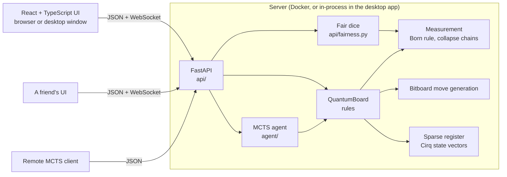

# Quantum Chess Engine

[](https://github.com/Andreas-Erick/Quantum-Chess-Engine/actions/workflows/ci.yml)


**Chess where a knight can be on two squares at once.** Pieces can split into **superposition**.
A piece that slides past an uncertain square becomes **entangled** with it. A capture forces a
**measurement** that collapses the board, sometimes in a chain reaction across several pieces.
The quantum state is simulated with Google's [Cirq](https://quantumai.google/cirq). Play against a
Monte Carlo Tree Search AI, learn the rules in an interactive tutorial, or play a friend online
with dice neither of you can rig, in the browser or the desktop app for Windows and macOS.

<picture>
  <source media="(prefers-color-scheme: dark)" srcset="docs/screenshot-dark.png">
  
</picture>

<sub>Faded pieces with a percentage are in superposition. Squares sharing a ring colour are
entangled. In this position, the white queen slid past the split knight on f3/h3, so it reached h5
only if the knight is on h3 (purple). Black's c-pawn did the same past the knight on a6/c6 (teal).</sub>

## Quick start

```bash
docker compose up --build
```

Open <http://localhost:8000> and play white against the AI, or open
<http://localhost:8000/docs> for the interactive API. New to quantum chess? Click **Learn to
play** for seven short interactive lessons.

<details>
<summary>Without Docker</summary>

```bash
python -m venv .venv && source .venv/bin/activate      # Windows: .venv\Scripts\activate
pip install -r requirements.txt
(cd ui && npm ci && npm run build)                      # optional: the UI served at /
uvicorn api.server:app
```

</details>

<details>
<summary>Desktop app</summary>

Download the installer from the
[releases page](https://github.com/Andreas-Erick/Quantum-Chess-Engine/releases):
`QuantumChess-Setup-<version>.exe` for Windows (no admin rights needed; adds a Start menu entry
and an uninstaller) or `QuantumChess-<version>.dmg` for macOS (drag the app to Applications).
Or run it from source:

```bash
pip install -r requirements-desktop.txt
(cd ui && npm ci && npm run build)
python -m desktop                          # the game in its own window, engine in-process
python -m desktop --lan                    # start hosting on your network right away
python -m desktop --server https://...     # open a hosted server instead of a local one
pip install --require-hashes -r requirements-desktop.lock   # the exact versions releases use
pyinstaller desktop/quantum_chess.spec     # build dist/QuantumChess yourself
iscc /DAppVersion=1.2.3 desktop/installer.iss   # then the Windows installer (Inno Setup 6)
python -m desktop.make_icon                # redraw the icons (needs pillow and fonttools)
```

The window is the system web view (Edge WebView2 on Windows, WebKit on macOS), showing the same UI
the server hosts. Pushing a `v*` tag builds both installers in CI and attaches them to a release.
Pull requests that change the app build them too, as a check.
The release is signed (Windows) and signed and notarized (macOS) when the repository has the
signing secrets listed at the top of [`desktop.yml`](.github/workflows/desktop.yml); without
them it is built unsigned.

</details>

<details>
<summary>Play a friend</summary>

**With the desktop app**, one player hosts and the other joins. No server to set up:

1. The host clicks **Host a game** in the **Play a friend** card. Their app starts accepting
   players from the local network, and the invite link points at it
   (`http://192.168.1.20:52814/?join=…`). Windows may ask to allow Quantum Chess Engine through the
   firewall the first time: allow it on **private networks only**. Host only on networks you
   trust, like your home Wi-Fi, and click **Stop hosting** when you're done (closing the app
   stops it too). Other machines can only join and play your online games, not start games or
   AI searches on your computer.
2. For a friend who isn't on the same network, the host clicks **Get an internet link** under
   the invite link. The app opens a free, temporary [Cloudflare quick
   tunnel](https://developers.cloudflare.com/cloudflare-one/connections/connect-networks/do-more-with-tunnels/trycloudflare/)
   to the same listener (no account needed), and the invite link changes to
   `https://<random words>.trycloudflare.com/?join=…`, which works from anywhere. The first time,
   the app installs `cloudflared` with winget (Windows) or Homebrew (macOS). **Stop hosting** or
   closing the app closes the tunnel, and the address never works again.
3. The friend pastes the link into **Join** in their own app, or opens it in any browser.
4. Moves appear on both screens instantly over a WebSocket, and each player can move only their
   own side. **Game ▸ My games** returns to your own games afterwards.

**In a browser**, click **Create invite link** and send it. That works whenever your friend can
reach the server: on the same network (`uvicorn api.server:app --host 0.0.0.0`), or anywhere if
you deploy the Docker image to a container host (Render, Fly.io, a VPS). Put it behind HTTPS so
the live feed runs over `wss://`.

**Playing over the internet without the desktop app's internet link.** A host's computer is
normally behind a home router, so a friend elsewhere can't reach it directly. Put both machines
on one private network with [Tailscale](https://tailscale.com) (free for personal use) and host
as above, or expose the server's port with a tunnel yourself
(`cloudflared tunnel --url http://localhost:<port>`) and invite with the tunnel's address.

**Fair dice.** When one player hosts, their app rolls the dice for every measurement, so it could
choose the outcomes. Both players seed the dice instead: the server commits to a secret (only its
SHA-256 is published) before the friend joins with a random seed of their own, measurement *n*
uses `sha256(secret ‖ seed ‖ n)`, and the secret is revealed when the game ends. The joiner then
replays the game with the same dice: **Game ▸ Verify this game's dice** in the desktop app, or
`python -m api.fairness <game link> --seed <your seed>`. The desktop app generates and keeps the
joiner's seed itself, out of the host's reach; a browser joining on the host's own page runs the
host's code, so it can only trust the host. A host running modified code could still *peek* at
upcoming outcomes during a game (the server must know the seed to roll), which only a neutral
server rules out. Details in [`api/fairness.py`](api/fairness.py).

</details>

## Highlights

- **Handles a huge state space.** A literal 64-qubit board would need 2^64 amplitudes. The engine
  simulates only the squares whose occupancy is uncertain, and splits those into independent
  entanglement groups. In random self-play, 25+ squares can be uncertain at once while the largest
  group stays around 19 qubits.
- **Real quantum mechanics, not dice rolls.** Moves are iSWAP-family unitaries, so pieces are
  conserved by construction. Relative phase matters: a split piece whose halves moved separately
  only partly recombines when merged.
- **Decoupled architecture.** The engine, REST API, AI and UI communicate only through a Pydantic
  JSON contract. The game history records every measurement outcome, so any client can rebuild
  the exact quantum state from JSON. The remote AI client does exactly that.
- **An AI for a game with randomness built in.** Open-loop MCTS averages over measurement
  outcomes in proportion to their true probabilities. Progressive widening keeps the search
  focused despite hundreds of possible splits per position. Improvements are measured, not
  guessed: an arena plays agent versions against each other.
- **Two players, fair dice.** Online games push every move over a WebSocket. The desktop app can
  host a game on the local network or join one. Measurement outcomes come from dice both players
  seed (commit–reveal), so a hosting player can't choose them, and the joiner can replay the
  finished game to check every outcome.
- **Tested hard where things are random.** 231 Python tests and 17 UI tests: perft-verified move
  generation, forced and statistical measurement outcomes, A→B→C entanglement chains, and
  random-play invariant checks. CI runs everything plus a Docker smoke test.

## How to play

Standard chess, plus three quantum moves. Notation follows Cantwell's *Quantum Chess*.

| Move | Notation | What happens |
|---|---|---|
| **Move** | `e2e4` | An ordinary move. A superposed piece moves *with* its uncertainty and isn't measured. |
| **Split** | `g1^f3h3` | A piece (not a pawn) moves to two empty squares at once, 50% each. A split piece can split again (50% → 25% + 25%), but no part may drop below 25%. |
| **Merge** | `f3h3^g1` | Two halves of a piece recombine. If neither half moved since the split, the piece is whole again with certainty. |
| **Slide** | `d1h5` past an uncertain square | The piece moves only in the branches where its path is empty, so it becomes **entangled** with the blocker. |

**Measurement.** Capturing or entering an uncertain square, or capturing *with* an uncertain piece,
asks the board a question, and nature answers with the true probability. If the answer makes the
move impossible (your attacker wasn't there after all), the move fails and your turn passes.
Collapsing one square settles everything entangled with it.

**Winning.** Capture the enemy king. A king in superposition can survive an attack that misses.
There is no checkmate, but the board warns about **check**: any square your king may be on that an
enemy piece could try to capture next move is outlined in red.

**Draws.** A game is drawn after 50 moves each with no pawn move, capture or measurement, or when
only the two kings are left.

**In the UI,** pick Move, Split or Merge, then click squares; only squares that complete a legal
move are highlighted. Hover an uncertain square to see how every square entangled with it depends
on it: ● is its probability if the hovered square is occupied, ○ if it is empty.

**AI strength.** Choose Easy, Medium or Hard in the Game panel. Easy searches briefly and misses
threats; Medium (the default) looks one move ahead; Hard thinks longer and deeper. The API takes
the same names: `POST /ai_move {"game_id": ..., "level": "hard"}`, and `GET /levels` lists them.

## Privacy and security

Quantum Chess Engine is a hobby project: reviewed for security, but not professionally audited. Host
games only with people you trust, and report problems privately as described in
[SECURITY.md](SECURITY.md).

- **No accounts, no tracking.** The app asks for no personal information, sends no analytics or
  crash reports, and never contacts a server of ours. Its only network traffic is the game itself,
  with a friend you host or join (relayed by Cloudflare if you use an internet link).
- **What it stores.** Finished lessons, your chosen AI level and your seats in online games (the
  web view's storage), the dice seeds of games you joined (`joined.json`), and a log. All of it
  lives in `%APPDATA%\QuantumChess` (Windows) or `~/Library/Application Support/QuantumChess`
  (macOS), and the Windows uninstaller removes it.
- **Listening on the network is opt-in.** The engine listens on `127.0.0.1` only, until you
  click **Host a game** (or start with `--lan`). **Stop hosting** closes the network listener,
  which only lets other machines join, watch and play your online games.
- **So is the internet.** Only **Get an internet link** makes that listener reachable from the
  internet, through a Cloudflare quick tunnel: anyone with the random address can then join or
  watch your online games, with the same limits as on your network. Cloudflare relays that
  traffic. The tunnel closes with **Stop hosting** or when the app closes; on Windows it can't
  outlive the app even if the app crashes.
- **Guests see only online games.** Through the network listener or the tunnel, your games
  against the AI don't exist, the API docs are off, and each game takes at most 16 live feeds.
  Anyone holding an invite link can take the open seat, so send it only to your friend.
- **The app's own server answers only the app.** It refuses requests addressed to any other
  host name, so a web page can't reach it by pointing a domain at 127.0.0.1 (DNS rebinding).
- **The window stays on known pages.** After you join, the host's page runs in your window, so
  the app keeps the window to its own pages and the games you joined, and sends it back if a page
  tries to go anywhere else. The host's page can't host, join or learn your local address.
- **No special permissions.** No camera, microphone, location, notifications or file access; the
  clipboard is written only when you click **Copy**. The installer needs no admin rights.
- **Builds are reproducible.** Release builds and the Docker image install exact versions from
  hash-checked lock files, and the workflows pin their actions to commits.

## How it works



- **Engine** (`engine/`): a perft-verified bitboard chess engine, plus a sparse quantum
  register. Only uncertain squares are qubits, kept in independent entanglement groups, so the
  cost grows with the largest group, not the number of uncertain squares.
- **AI** (`agent/`): open-loop Monte Carlo Tree Search that averages over the quantum dice, with
  probability-weighted evaluation and three strength levels.
- **API** (`api/`): FastAPI with a WebSocket live feed, online seats and jointly seeded,
  verifiable dice.
- **UI** (`ui/`) and **desktop app** (`desktop/`): React 19, TypeScript and Vite, in a browser
  or a native window that can host friends.

## Documentation

| | |
|---|---|
| [docs/architecture.md](docs/architecture.md) | The layers, the state model, the life of a move, security boundaries, and how to add rules, endpoints, AI levels, lessons and UI features |
| [docs/api.md](docs/api.md) | Endpoints, responses, the live feed, errors, and using the engine from Python |
| [CONTRIBUTING.md](CONTRIBUTING.md) | Setup, running, checks, conventions and releasing |
| [CHANGELOG.md](CHANGELOG.md) | What changed in each release |
| [SECURITY.md](SECURITY.md) | Reporting vulnerabilities, and the known limitations |

## Limitations and next steps

- The AI looks ahead only a few moves and still loses to deeper tactics. Measured in the arena:
  the threat-aware evaluation and root lookahead beat the original agent 82% of the time (160
  games, equal iterations), and narrowing progressive widening from 2·√n to 0.7·√n added another
  83% (96 games). Medium beats Easy 92% and Hard beats Medium 74%.
- En passant is not available in quantum play, and pawns cannot split.
- Games are stored in memory; a restart clears them, including online games in progress. The
  server keeps the 500 most recently used (`QC_MAX_GAMES`). Redis or a database would make the
  API stateless; the live feed would then need a pub/sub channel.
- A public server lets anyone start AI searches (up to 60 s each). Deploy behind a rate limit if
  that matters; the desktop app's network listener refuses them outright.
- There are no accounts: whoever holds a seat token plays that side, and anyone with the game
  link can watch.
- Playing over the internet from the desktop app goes through a Cloudflare quick tunnel, which
  depends on Cloudflare's free service and relays the game's traffic. There is no direct
  peer-to-peer connection.
- Until signing certificates are added to the repository, the desktop builds are unsigned, so
  Windows SmartScreen and macOS Gatekeeper warn on first launch.

## Acknowledgements

The move set and notation follow Chris Cantwell's *Quantum Chess*. The quantum simulation uses
[Cirq](https://quantumai.google/cirq). The app icon's knight is the ♞ glyph of
[DejaVu Sans](https://dejavu-fonts.github.io/) ([license](https://dejavu-fonts.github.io/License.html)).
Internet play uses [Cloudflare quick tunnels](https://developers.cloudflare.com/cloudflare-one/connections/connect-networks/do-more-with-tunnels/trycloudflare/).

## License

[MIT](LICENSE) © 2026 Andreas Erick
