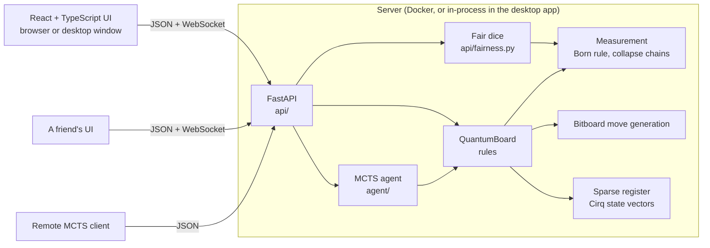
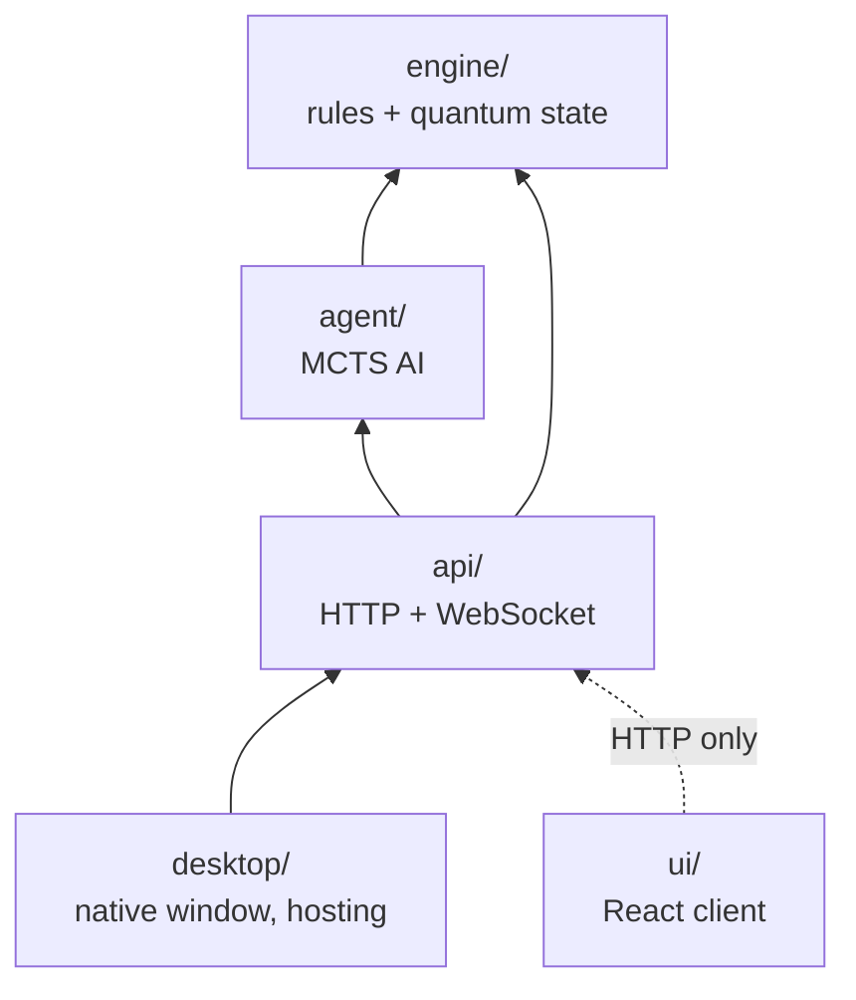
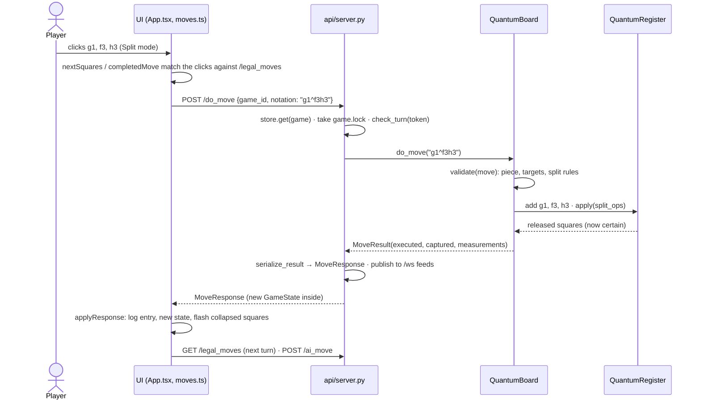

# Architecture

How Quantum Chess Engine is put together: the layers, what each one owns, how a move travels
through them, and where to make common changes. For the JSON contract see [api.md](api.md); for
setup, checks and releasing see [CONTRIBUTING.md](../CONTRIBUTING.md).

- [Overview](#overview)
- [Layers and the dependency rule](#layers-and-the-dependency-rule)
- [Engine](#engine-engine)
- [The life of a move](#the-life-of-a-move)
- [AI](#ai-agent)
- [API server](#api-server-api)
- [UI](#ui-ui)
- [Desktop app](#desktop-app-desktop)
- [Security boundaries](#security-boundaries)
- [Project layout](#project-layout)
- [Extending the project](#extending-the-project)

## Overview



One Python process holds the games. The same FastAPI app runs in the Docker image and inside
the desktop app. Every client, the bundled UI included, talks to it only through the public
JSON API and the `/ws` live feed.

## Layers and the dependency rule



Each layer may import only the layers below it. `engine` imports none of the others, `agent`
only `engine`, `api` both, and `desktop` only `api`. The UI is a separate program that knows the
server only through HTTP. `tests/test_architecture.py` enforces this, so the engine stays
usable on its own: in a notebook, another server, or a different AI.

## Engine (`engine/`)

| Module | Owns |
|---|---|
| `bitboard.py` | Square numbering (a1 = 0 … h8 = 63), attack tables, sliding-piece rays. |
| `classical.py` | `ClassicalBoard`: a complete, perft-verified chess engine (FEN, castling, en passant, promotion, every draw rule). |
| `register.py` | `QuantumRegister`: the sparse quantum state, as independent Cirq state vectors. |
| `moves.py` | `QuantumMove` (jump, split, merge), its notation, and the iSWAP-family gates for each move. |
| `measurement.py` | `ProbabilityResolver`: samples outcomes by the Born rule and collapses the state. |
| `board.py` | `QuantumBoard`: the rules of quantum chess, built from all of the above. This is the class everything else uses. |

### The state model

A `QuantumBoard` position is two things side by side:

- **Labels.** For each of the 64 squares, the piece that *would* be there if the square is
  occupied (`board.labels`, a list of `Piece | None`). Labels never hold probabilities.
- **The register.** Only squares whose occupancy is *uncertain* are qubits
  (`cirq.GridQubit(rank, file)`, |1⟩ = occupied). They live in **independent groups**, each with
  its own state vector. Groups merge (a tensor product) only when a gate or measurement spans
  them, which happens when pieces actually interact. A square leaves the register the moment its
  probability is exactly 0 or 1 again (`release_definite`).

So the simulation costs 2^(largest group), not 2^(uncertain squares). A typical game keeps
groups small. The AI stops a rollout once a group passes 12 qubits.

`board.probability(sq)` reads a square's occupancy. `board.joint_probability({sq: bool, ...})`
reads correlations. That's how the UI shows "if this square is occupied, that one is 30%".

### Moves and gates

All gates conserve the number of |1⟩ qubits, so a unitary can move and spread pieces but never
create or destroy one. Only a measurement followed by a capture removes a piece.

| Move | Notation | Unitary |
|---|---|---|
| Jump | `e2e4`, `e7e8q` | `iSWAP(source, target)` |
| Split | `b1^a3c3` | `√iSWAP(source, t1)`, then `iSWAP(source, t2)` |
| Merge | `a3c3^b1` | inverse of split |
| Slide | (a jump through uncertain squares) | `iSWAP(source, target)` controlled on every path square being empty |

A capture along an uncertain path makes a **path measurement**, which answers only "is the path
clear?". If the path is blocked, the possible blockers stay uncertain, now entangled with each
other.

### Rules that differ from chess

- A game is won by **capturing the king**. There is no checkmate. `king_threats()` reports which
  possible king squares the opponent could capture next move, which the UI shows as check.
- A split part must stay at least `MIN_SPLIT_FRAGMENT` (25%) likely: 100% → 50% → 25%.
- Pawns can't split, and there's no en passant in quantum play.
- A move that needs to know whether a square is occupied **measures** it. If the outcome makes
  the move impossible (the attacker wasn't there, or the target is your own piece), the move
  fails and the turn still passes.
- Draws: 100 plies without a pawn move, capture or measurement (`FIFTY_MOVE_PLIES`), or only
  kings left.

## The life of a move

Clicking a knight on g1, then f3 and h3, in a game against the AI:



In code:

1. **Picking squares** (`ui/src/moves.ts`). The UI doesn't know the rules. `nextSquares` offers
   the squares that continue some legal move from `/legal_moves`, and `completedMove` turns the
   clicks into notation once they match exactly one.
2. **The request** (`ui/src/api.ts` → `POST /do_move`). Online games add the seat token.
3. **The server** (`api/server.py`, `do_move`) finds the game, holds its lock for the whole move,
   refuses a move out of turn in an online game, and calls the engine.
4. **The engine** (`engine/board.py`, `QuantumBoard.do_move`):
   - `validate` checks the move's shape against the possible board, using the classical
     layer's move patterns.
   - `_split`, `_merge` or `_jump` add the touched squares to the register, and apply gates or
     measure. `_jump` handles captures, slides and path measurements.
   - After the move, castling rights, the draw clock, the winner and the turn are updated, and
     the `MoveResult` is appended to `history`.
5. **The response** (`serialize_result`) lists each measurement: what was asked, its prior
   probability, the outcome, and every square that collapsed. The same message goes to every
   `/ws` subscriber, so a friend's screen updates at once.
6. **The UI** (`applyResponse`) appends the move log entry, shows the new state, and flashes the
   collapsed squares.

## AI (`agent/`)

Minimax breaks down when every capture can branch on a random outcome. The agent uses
**open-loop MCTS** (`mcts.py`): tree nodes are move sequences, and each iteration replays them on
a fresh copy of the position with newly sampled measurements. The statistics on each node
therefore average over the quantum dice.

- **Progressive widening.** A node considers about 0.7·√visits candidates, so a queen's ~200
  possible splits don't drown out the good moves. At the root, every move is first played on a
  copy and scored one move ahead. Deeper nodes order captures by expected value, then interleave
  ordinary and quantum moves.
- **Evaluation** (`heuristics.py`). Material and centrality are weighted by the probability that
  each piece is really there, minus a penalty for a king in superposition. A *threat* term
  credits the side to move with part of its best available capture.
- **Rollouts** take a king capture whenever one exists, prefer captures, and play a quantum move
  only 15% of the time.
- **Levels** (`levels.py`) are named option sets for `MCTSAgent`, shared by the API, the UI and
  the command-line client. `arena.py` plays agents against each other to measure changes.

## API server (`api/`)

- **`schemas.py`** is the JSON contract (Pydantic). Every input has a length limit, and the UI
  mirrors these types in `ui/src/types.ts`.
- **`server.py`**, `create_app()`, builds the FastAPI app:
  - `GameStore` keeps at most `QC_MAX_GAMES` (500) games in memory and forgets the least
    recently used.
  - Each `Game` has a `threading.Lock`. Every read and move holds it, and an AI search holds it
    for the whole search (seconds). That's why the WebSocket handler never takes it on the
    event loop.
  - **Online games** have two seats, each with a secret token. Moves need the token of the side
    to move, and are refused until both seats are taken.
  - **Live feeds** (`/ws`): a `state` message on connect and when a player joins, and a `move`
    message after every move. At most `MAX_FEEDS` (16) per game.
- **`fairness.py`**: in online games both players seed the dice. The server commits to a secret
  (publishing its SHA-256) before the friend joins with their own seed, so neither side can pick
  outcomes, and the joiner can verify the game afterwards.

## UI (`ui/`)

React 19, TypeScript and Vite. FastAPI serves the built app (`ui/dist`) at `/`. During
development, Vite serves it on :5173 and proxies API calls to :8000.

- **`App.tsx`** holds the game flow: local games against the AI, the tutorial, online games, and
  the desktop bridge. It's the largest UI file; new features are best added as their own hooks
  or components rather than more state here.
- **`components/`**: `Board` (rendering only), `MoveLog`, `TutorialCard`, `OnlineCard`.
- **`moves.ts`**: clicks → move notation, driven entirely by the legal-move list.
- **`live.ts`**: the `/ws` feed with reconnects. **`storage.ts`**: per-browser state (the
  resumed game, seats and seeds, finished lessons).
- **`tutorial/lessons.json`**: the seven lessons as data. `tests/test_tutorial.py` replays every
  lesson on the engine and checks what its text claims.

## Desktop app (`desktop/`)

`app.py` starts the FastAPI app in-process on `127.0.0.1` and shows the UI in a native web view
(pywebview: WebView2 on Windows, WebKit on macOS). The page reaches Python through
`window.pywebview.api`, which is the public methods of the `Desktop` class.

- **Host a game** starts a second listener for the same app on `0.0.0.0`, wrapped in
  `GuestsOnly`.
- **Get an internet link** (`tunnel.py`) runs `cloudflared tunnel --url` to that listener and
  reads the public `trycloudflare.com` address from its log. On Windows a job object ties
  cloudflared's lifetime to the app's.
- **Joining** happens in Python (`join_game`), so the joiner's dice seed stays out of the host's
  reach.
- Builds: `quantum_chess.spec` (PyInstaller), `installer.iss` (Inno Setup), and the
  `desktop.yml` workflow for Windows and macOS.

## Security boundaries

Where untrusted input enters, and what guards it. Anything that touches these paths needs a
test for the guard. [SECURITY.md](../SECURITY.md) lists the accepted limitations.

| Boundary | Untrusted side | Guard |
|---|---|---|
| Hosting listener and tunnel | Anyone with the address | `GuestsOnly` (`desktop/app.py`): refuses `HOST_ONLY_PATHS` (new games, AI searches, docs) and marks requests as guests. Guests see only online games (`GameStore.get(..., guest=True)`). |
| The app's local server | Web pages in the player's browser | `LocalOnly`: answers only requests addressed to `127.0.0.1`/`localhost` on its port (DNS rebinding). |
| The desktop bridge | A host's page, after joining | Methods that act on the machine check `_on_own_page()`. Only intended methods are public, and a test pins the list. The window is sent home from pages the app didn't open (`_check_page`). |
| Online moves | The other player and spectators | Seat tokens, compared in constant time. Two seats only. |
| All requests | Anyone | Pydantic length limits on every field, the LRU game store, the feed cap. |

## Project layout

```
engine/
  bitboard.py       square indexing, attack tables, ray-based slider attacks
  classical.py      ClassicalBoard: FEN, legal moves, make/unmake, game outcomes
  register.py       sparse register: independent Cirq-simulated entanglement groups
  moves.py          jump / split / merge / slide, notation, iSWAP-family gates
  measurement.py    Born-rule sampling, collapse, chain reactions
  board.py          QuantumBoard: ties the classical and quantum layers together
agent/
  heuristics.py     probability-weighted evaluation with a one-capture threat term
  mcts.py           open-loop MCTS with progressive widening and root lookahead
  levels.py         named strength levels (easy, medium, hard)
  arena.py          agent-vs-agent matches for measuring strength
  client.py         remote agent that plays using only the API
api/
  schemas.py        Pydantic models: the JSON contract
  server.py         FastAPI endpoints, online seats, /ws live feed, serves the UI
  fairness.py       jointly seeded dice for online games, and verifying them
desktop/
  app.py            native window, in-process server, hosting and joining, Game menu
  tunnel.py         internet links: Cloudflare quick tunnels to the hosting listener
  make_icon.py      draws icon.png / .ico / .icns and ui/public/favicon.svg
  quantum_chess.spec, installer.iss   PyInstaller build and the Windows installer
  sign-windows.ps1, entitlements.plist   release signing (Windows), hardened runtime (macOS)
ui/src/
  App.tsx           game flow: local, AI, tutorial and online games
  components/       Board, MoveLog, TutorialCard, OnlineCard
  tutorial/         lessons.json and its types
  api.ts, types.ts  the JSON contract, mirrored from api/schemas.py
  live.ts           live-feed WebSocket with reconnects
  desktop.ts        the desktop app bridge
  storage.ts        per-browser state
  moves.ts          clicks -> move notation, driven by the legal-move list
scripts/            bump_version.py, release_notes.py
tests/              one file per area, e.g. test_entanglement.py, test_api.py, test_desktop.py
docs/               this guide, the API reference, README screenshots
```

## Extending the project

### A new rule or move type

1. Add it to `MoveType` and `QuantumMove` in `engine/moves.py`, with notation, `parse`,
   `notation()`, and a function returning its gates. Gates must conserve occupancy, like the
   iSWAP family.
2. Handle it in `QuantumBoard`: `validate`, `legal_moves`, and a `_<move>` method dispatched
   from `do_move`.
3. Test it in the engine first. `tests/test_superposition.py` and
   `tests/test_entanglement.py` show how to check probabilities and collapses.
4. The API needs no change if the move has notation (`/do_move` accepts `notation`). The UI needs
   a mode in `ui/src/moves.ts` and in `MODES` in `App.tsx`.

### An API endpoint

1. Add request and response models to `api/schemas.py`, with length limits on every string.
2. Add the route in `create_app()` in `api/server.py`. Look games up with
   `store.get(game_id, is_guest(http))`, and hold `game.lock` while touching the board.
3. If guests shouldn't call it (it creates games or costs CPU), add its path to
   `HOST_ONLY_PATHS` in `desktop/app.py`.
4. Mirror the types in `ui/src/types.ts` and add a call in `ui/src/api.ts`. Document it in
   [api.md](api.md). Test it in `tests/test_api.py`, plus `tests/test_desktop.py` if guests are
   involved.

### An AI level or AI change

Add a `Level` to `LEVELS` and its name to `LevelName`, both in `agent/levels.py` (the API's
schemas import it), and to `LevelName` in `ui/src/types.ts`. `tests/test_contract.py` fails if
they disagree. The UI's level picker and `agent.client --level` then list it from `/levels`. Measure any AI change with the arena before keeping it:

```bash
python -m agent.arena --games 40 --a iterations=400 --b iterations=100
```

### A tutorial lesson

Add an entry to `ui/src/tutorial/lessons.json`: a FEN, optional `setup` moves, and steps with
the move prefixes they `accept`, a `prompt`, an optional scripted `reply`, and an `explain` on
the last step. `tests/test_tutorial.py` checks that it is playable on the real engine.

### A UI panel or feature

Put it in its own component under `ui/src/components/`, with its state in a hook rather than
more `useState` in `App.tsx`. Server data comes through `ui/src/api.ts`, and live updates through
`useLiveFeed`. UI tests use Testing Library with a stubbed `fetch`; see `ui/src/Features.test.tsx`.
